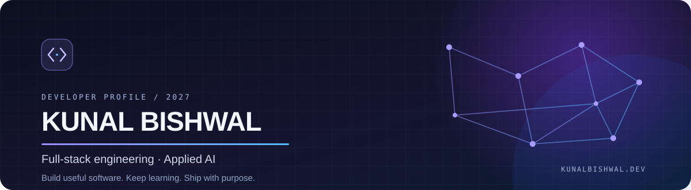
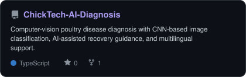
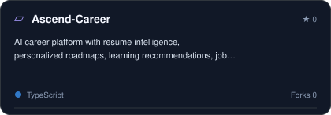
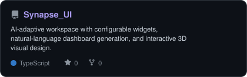
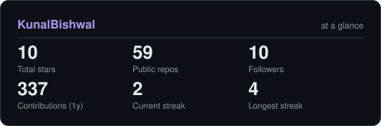
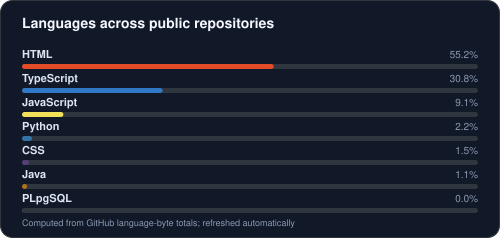

<!-- Kunal Bishwal | Inspired by terminal banners, SVG radars, and self-hosted cards from emmi-lili/emmi-lili -->

<picture>
  <source media="(prefers-color-scheme: dark)" srcset="assets/banner-dark.svg">
  <source media="(prefers-color-scheme: light)" srcset="assets/banner-light.svg">
  
</picture>

 

 

&nbsp;&nbsp;
&nbsp;&nbsp;

 

&nbsp;

---

## Hey, I'm Kunal.

I'm a Computer Science student at **SRM Institute of Science and Technology (Class of 2027)**. I enjoy engineering end-to-end web products and bringing practical AI into applications people can use.

My interests sit at the intersection of **full-stack development, applied AI/ML, and developer tools**—from interfaces and backend APIs to data layers, computer vision, and LLM-powered workflows.

- **Building around:** React / Next.js, TypeScript, Node.js, Python, databases, and AI integrations.
- **Exploring:** Applied AI, computer vision, RAG, cloud infrastructure, and reliable software design.
- **Looking for:** Software Engineer / SDE-1, Full-Stack, and applied AI/ML opportunities for the 2027 graduate cohort.
- **Find me:** [LinkedIn](https://linkedin.com/in/itzkunalbishwal) · [LeetCode](https://leetcode.com/u/kunalbishwal2004/) · [X](https://x.com/KunalBishwal18)

---

## My everyday stack

---

## Signals

<table>
  <tr>
    <td width="50%" align="center" valign="middle">
      <picture>
        <source media="(prefers-color-scheme: dark)" srcset="assets/radar-dark.svg">
        <source media="(prefers-color-scheme: light)" srcset="assets/radar-light.svg">
        
      </picture>
    </td>
    <td width="50%" align="center" valign="middle">
      <picture>
        <source media="(prefers-color-scheme: dark)" srcset="assets/radar-stack-dark.svg">
        <source media="(prefers-color-scheme: light)" srcset="assets/radar-stack-light.svg">
        
      </picture>
    </td>
  </tr>
</table>

Focus maps are editable self-assessments, not objective proficiency benchmarks.

 

<picture>
  <source media="(prefers-color-scheme: dark)" srcset="assets/radar-langs-dark.svg">
  <source media="(prefers-color-scheme: light)" srcset="assets/radar-langs-light.svg">
  
</picture>

Language radar is calculated from GitHub's language-byte data across public repositories.

---

## Selected projects

<a href="https://github.com/KunalBishwal/ChickTech-AI-Diagnosis">
  <picture>
    <source media="(prefers-color-scheme: dark)" srcset="assets/card-ChickTech-AI-Diagnosis-dark.svg">
    <source media="(prefers-color-scheme: light)" srcset="assets/card-ChickTech-AI-Diagnosis-light.svg">
    
  </picture>
</a>
<a href="https://github.com/KunalBishwal/Ascend-Career">
  <picture>
    <source media="(prefers-color-scheme: dark)" srcset="assets/card-Ascend-Career-dark.svg">
    <source media="(prefers-color-scheme: light)" srcset="assets/card-Ascend-Career-light.svg">
    
  </picture>
</a>
<a href="https://github.com/KunalBishwal/Synapse_UI">
  <picture>
    <source media="(prefers-color-scheme: dark)" srcset="assets/card-Synapse_UI-dark.svg">
    <source media="(prefers-color-scheme: light)" srcset="assets/card-Synapse_UI-light.svg">
    
  </picture>
</a>

**ChickTech AI Diagnosis** — Computer-vision poultry disease diagnosis with CNN-based classification, AI-assisted recovery guidance, and multilingual support.

**Ascend Career** — Career platform with resume intelligence, personalized roadmaps, learning recommendations, job discovery, and voice-enabled mentoring.

**Synapse UI** — AI-adaptive workspace with natural-language dashboard generation, configurable widgets, and interactive 3D visuals.

---

## Numbers, generated in this repo

<picture>
  <source media="(prefers-color-scheme: dark)" srcset="assets/card-stats-dark.svg">
  <source media="(prefers-color-scheme: light)" srcset="assets/card-stats-light.svg">
  
</picture>

 

<picture>
  <source media="(prefers-color-scheme: dark)" srcset="assets/card-languages-dark.svg">
  <source media="(prefers-color-scheme: light)" srcset="assets/card-languages-light.svg">
  
</picture>

---

### Let's build something meaningful.

Connect with me about full-stack products, practical AI, and developer tools.

<a href="https://linkedin.com/in/itzkunalbishwal">LinkedIn</a> ·
<a href="https://github.com/KunalBishwal">GitHub</a> ·
<a href="https://leetcode.com/u/kunalbishwal2004/">LeetCode</a>

  

Build with curiosity. Ship with purpose.

<!--
Visual-generation code adapted from the reference repository:
https://github.com/emmi-lili/emmi-lili
The project uses local SVG outputs generated by scripts/cards.py and scripts/radar.py,
plus the custom banner in scripts/profile_assets.py.
-->
